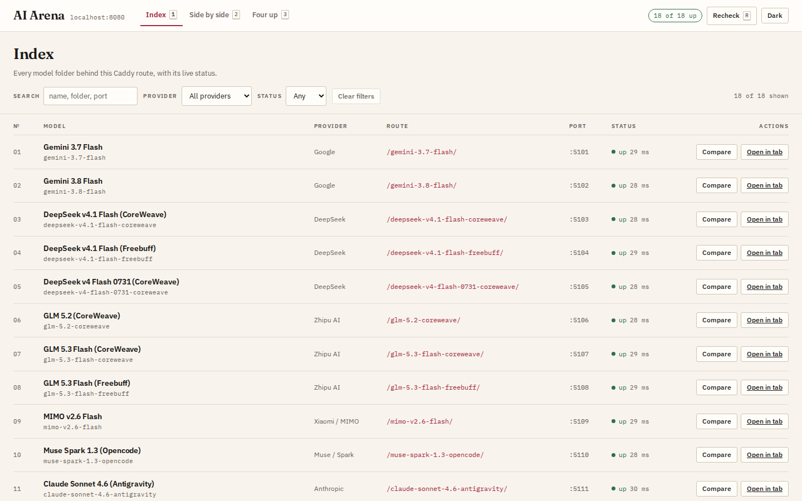

# AI Arena

One brief, eighteen models, eighteen takes.

`prompt.txt` asks for "Pocket World": an interactive Three.js diorama of a
floating island, built from code, with no downloaded models, textures, HDRIs or
asset packs. Every folder at the top of this repository is one model's finished
answer to that brief, named after the model that wrote it. They all run side by
side behind one Caddy route, with a console for looking at them together.

## Running it

With Docker, which needs nothing else on the machine:

    docker compose up -d --build
    open http://localhost:8080/

The image builds all eighteen worlds and runs them in a single container. Caddy
routes `/<folder>/` to its own static server per world, and only port 8080
leaves the container. Stopping it again:

    docker compose down

Without Docker, if node, Caddy and tmux are already installed:

    ./arena.sh --start
    ./arena.sh --stop

That mode serves each world's existing `dist/` and skips any folder that has not
been built yet.

## What is where

`aggregator/` is the console. It reads `models.json`, sends a real request to
every route, and shows which worlds answer. `DESIGN.md` records why it looks the
way it does, including the measured contrast ratio of every text pairing in both
themes.

`Caddyfile` and `docker/Caddyfile` hold the routing. The first one is for a
Caddy running on your machine, the second for the container, where the upstreams
become `127.0.0.1:<port>`.

`Dockerfile`, `docker/` and `docker-compose.yml` build the container. Each world
is built in its own Docker stage, so changing one world rebuilds that world only
and leaves the other seventeen cached. A cold build of all eighteen takes about
80 seconds on this machine; rebuilding one takes about 12.

`PORT_RULES.md` lists the port of every world, explains where those numbers come
from, and names the four places to touch when adding another one.

## Adding a world

Put the folder in, register it in `aggregator/models.json` and both Caddyfiles,
then copy one build stage inside the `Dockerfile`. Section 3 of `PORT_RULES.md`
has the exact lines. Its supervisord entry is generated from `models.json` at
build time, so the port it listens on cannot drift from the table.

## Notes

- Every scene generates its geometry, materials and textures at runtime, which
  is what the brief required.
- The status column in the console comes from a real request to each route. A
  world that is down reads as down.
- This is a comparison harness, not production software.
