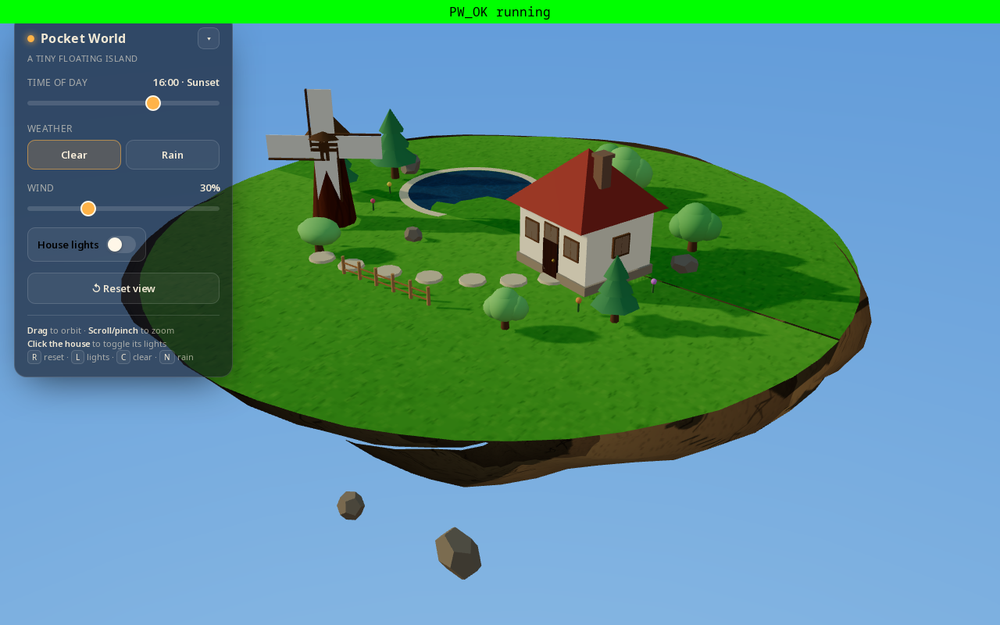
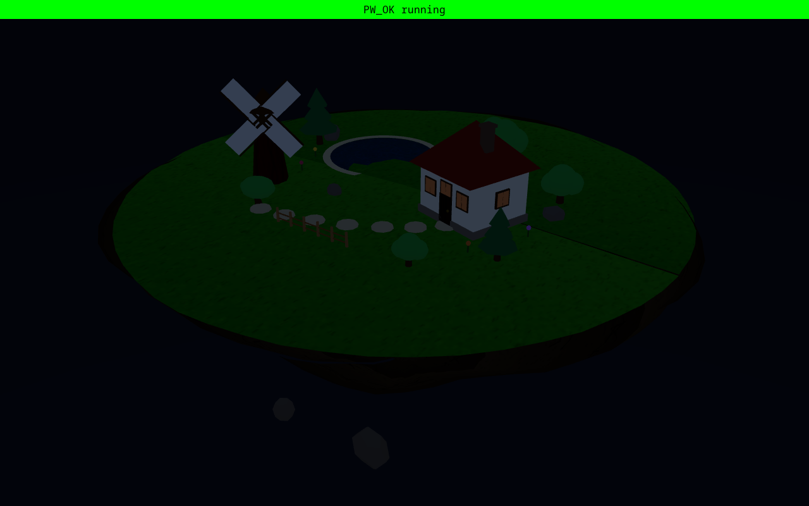
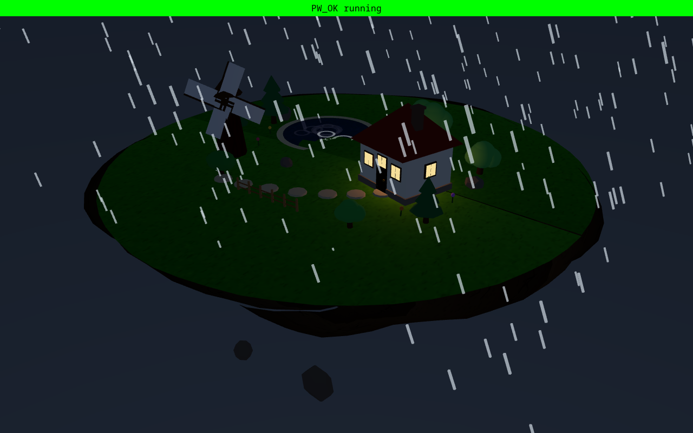
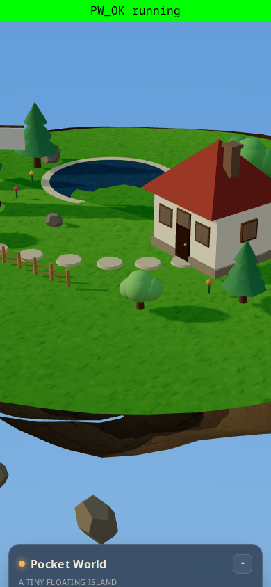

# Pocket World

An interactive 3D diorama of a tiny floating island — a handmade-feeling
digital toy built with Three.js, Vite and TypeScript. Everything is generated
in code (no downloaded models, images, HDRIs or external assets) and runs
entirely in the browser.

## Screenshots

| Default (16:00, clear) | Night (23:00) |
|---|---|
|  |  |

| Rainy night with lights on | Mobile layout |
|---|---|
|  |  |

## What's inside

- A floating island with a grassy domed top, an irregular rocky silhouette,
  a sculpted tapered underside, and a few small companion rocks.
- A small cottage with a pyramidal roof, door, knob, windows, chimney and
  architectural trim. Its windows glow (and a warm light comes on) when lit.
- A small pond inset into a carved grass basin with a sandy shoreline.
- Several trees of varied silhouettes (round, conifer, bonsai).
- A windmill with clearly visible rotating blades.
- Clouds, a winding stepping-stone path, a picket fence, flowers and rocks.

## Interactions

- **Orbit / zoom** — drag to orbit, scroll or pinch to zoom. Panning is
  disabled and distance/polar limits keep the island framed.
- **Time of day** — a 24h slider drives sun direction, light color, sky
  gradient, brightness, stars/moon and window prominence. Smooth transitions
  through day → sunset → night.
- **Weather** — Clear / Rain. Rain is 3D instanced streaks that slant with the
  wind and recycle at the island surface; the pond gets ripples and the sky
  darkens. Fades smoothly in and out.
- **Wind** — one shared wind state drives the windmill speed, tree/flower
  sway, cloud drift and rain slant simultaneously.
- **House lights** — click the house, or use the panel switch / `L` key.
  Both update the same state.
- **Reset** — restores the initial camera plus time 16:00, clear weather,
  wind 30% and lights off.

Keyboard: `R` reset · `L` lights · `C` clear · `N` rain.

## Run it

Requires Node 18+.

```bash
npm install      # install dependencies
npm run dev      # start the Vite dev server (http://localhost:5173)
npm run build    # type-check + production build to dist/
npm run preview  # preview the production build (http://localhost:4173)
npm run typecheck  # tsc --noEmit
```

Open the dev URL in a browser. The app needs WebGL.

## Architecture

Single coherent `WorldState` (time, weather, wind, lights) is the source of
truth; every scene effect is derived from it each frame.

- `src/state.ts` — state shape, defaults, time formatting.
- `src/utils.ts` — math, color and smoothing helpers (frame-rate independent).
- `src/textures.ts` — procedural canvas textures (grass, rock, wood, water).
- `src/world/` — scene construction: `Sky`, `Island`, `House`, `Trees`,
  `Windmill`, `Pond`, `Clouds`, `Decorations`, and `World` (renderer, camera,
  OrbitControls, update loop).
- `src/effects/Rain.ts` — pooled instanced 3D rain.
- `src/interaction.ts` — click-vs-drag detection for the house.
- `src/ui.ts` — the control panel (labeled, keyboard-friendly, responsive).
- `src/main.ts` — wires state, world, UI, interaction, the RAF loop,
  keyboard shortcuts, resize and the WebGL fallback.

## Notes

- Motion respects `prefers-reduced-motion` (decorative sway is reduced while
  functional controls keep working).
- Frame deltas are clamped so returning from a background tab doesn't jump.
- Rain particles and ripples are pooled/reused, never created per frame.
- Pixel ratio is clamped (2 on desktop, 1.5 on mobile) for smooth performance.
